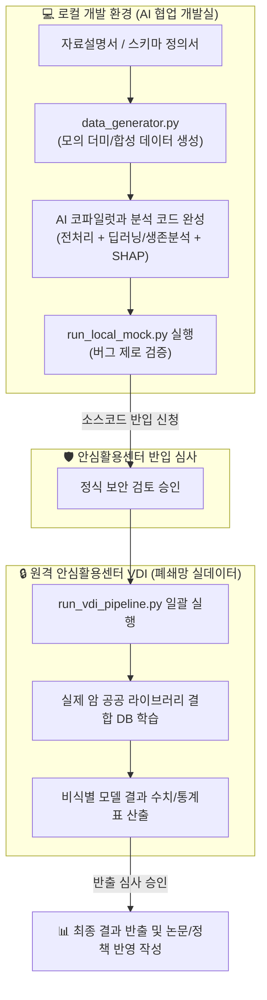

# Cancer Control: 암 장기 생존자 만성질환 및 사망위험 예측 AI 파이프라인

[](https://github.com/wonjulifestory/cancer-control)
[](docs/RFP_SUMMARY.md)
[]()
[]()

> **보건복지부 암정복추진연구개발사업 (RFP 1-2. 암 공공데이터 활용을 통한 근거생성 연구)**  
> **국가암데이터센터 K-CURE 암 공공 라이브러리 기반 인공지능/딥러닝 예측 모델 파이프라인**

---

## 📌 1. 연구 배경 및 목적
1. **암 생존율 향상과 질병부담 전환**: 암 5년 상대생존율이 70%를 상회하고 암 생존자가 200만 명을 돌파함에 따라, 진단 5년 이상 경과한 **장기 생존자의 심뇌혈관질환, 당뇨병 등 만성질환 발생 및 비암 사망 위험**이 핵심 건강 난제로 부각되었습니다.
2. **K-CURE 공공 라이브러리 활용**: 국립암센터(국가암데이터센터)가 구축한 중앙암등록자료, 건보공단 검진·자격, 심평원 청구, 통계청 사망원인 결합 데이터를 활용합니다.
3. **투트랙(Two-Track) AI 연구**: 폐쇄망(의료데이터 안심활용센터 VDI) 규제를 준수하면서, 로컬 환경의 생성형 AI와 협업하여 개발·디버깅을 완료하고 VDI 내부로 반입하여 실데이터 모델을 학습시키는 최적의 분석 파이프라인을 제공합니다.

---

## 🏗️ 2. 시스템 아키텍처 (Two-Track AI 파이프라인)



---

## 📂 3. 디렉토리 구조

```text
cancer-control/
├── README.md                      # 프로젝트 소개 및 실행 가이드
├── requirements.txt               # 환경 의존성 목록
├── docs/
│   ├── RFP_SUMMARY.md             # 암정복추진과제 RFP 1-2 분석 및 성과목표
│   ├── DATA_SCHEMA_GUIDE.md       # K-CURE 공공 라이브러리 결합 스키마 가이드
│   └── VDI_INGRESS_GUIDE.md       # 안심활용센터 코드 반입/반출 실무 매뉴얼
├── src/
│   ├── config.py                  # 연구 설정 (경로, 하이퍼파라미터, 질병 코드 등)
│   ├── data_generator.py          # 로컬 개발용 합성/더미 데이터 생성기
│   ├── preprocess.py              # 전처리 및 Feature Engineering (CCI, 약제, 병기)
│   ├── evaluate.py                # C-index, Time-dependent AUC, Brier Score 평가
│   ├── explain.py                 # SHAP 기반 XAI(설명가능 인공지능) 분석
│   └── models/
│       ├── survival_models.py     # Cox-PH, Random Survival Forest, Fine-Gray (경쟁위험)
│       └── deep_models.py         # DeepSurv / Dynamic-DeepHit 딥러닝 신경망
└── scripts/
    ├── run_local_mock.py          # 로컬 모의 파이프라인 원클릭 실행 스크립트
    └── run_vdi_pipeline.py        # VDI 환경용 배치 실행 스크립트
```

---

## 🚀 4. 빠른 시작 가이드 (Quick Start)

### 1) 가상환경 구성 및 패키지 설치
```bash
python3 -m venv venv
source venv/bin/activate
pip install -r requirements.txt
```

### 2) 로컬 환경에서 모의 데이터로 전체 파이프라인 검증
```bash
python scripts/run_local_mock.py --samples 2000 --model deepsurv
```
* **결과**: `outputs/` 디렉토리에 전처리 요약, 모델 C-index 평가표, SHAP 변수 중요도 시각화 결과가 자동 생성됩니다.

### 3) VDI 반입 및 실데이터 실행
* `docs/VDI_INGRESS_GUIDE.md`를 참고하여 `src/` 및 `scripts/run_vdi_pipeline.py`를 안심활용센터에 반입 신청합니다.
* VDI 접속 후:
```bash
python scripts/run_vdi_pipeline.py --data_path /path/to/k_cure_real_db
```

---

## 🎯 5. 연구 목표 및 기대 성과 (RFP 요건)
* **논문 실적**: JCR 상위 30% 이내 SCIE 1편 이상 (임상종양학 / 헬스케어 AI 저널)
* **정책 반영**: 암생존자통합지지센터 및 만성질환관리 사업 연계 프로토콜 1건 이상 제안
* **가점 혜택**: 권역암센터 소속기관 연구진 공동 참여 연계 (0.5점 가점 확보 전략)

---

## 📜 라이선스
MIT License (보건의료 연구 목적 자유 활용 가능)
